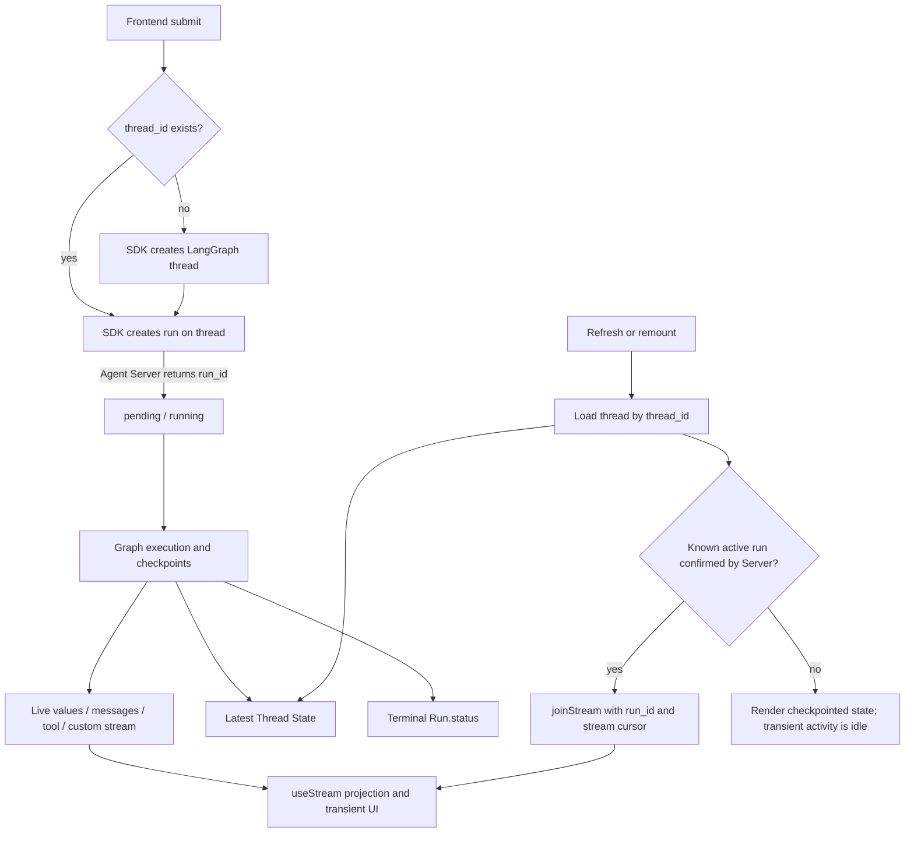
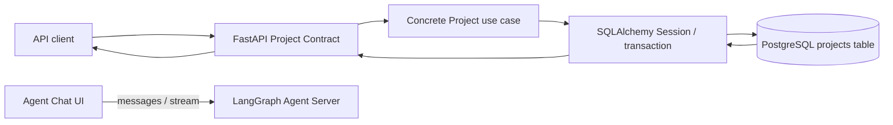
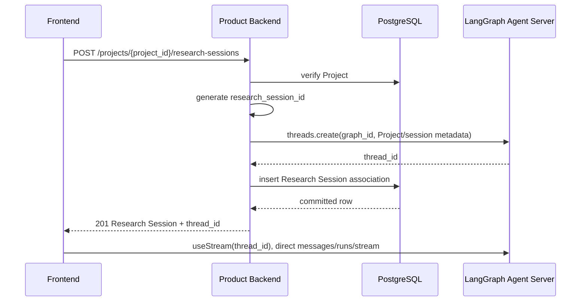
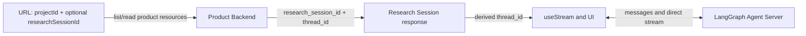

# ResearchFlow Architecture

This document records cross-module boundaries that are already needed by the
implemented system. It is not a target-state inventory.

## Run, State, Event, and Recovery Boundary

**Decision:** D-008  
**Scope:** P2-003  
**Status:** Accepted

### Current Repository Facts

- `langgraph.json` registers the Agent graph as `researchflow` on LangGraph
  Agent Server.
- The current Graph State contains `messages`, internal `research_query` and
  provisional `evidence`, plus the final `report`. The Writer also appends the
  Report as the final AI message.
- The Frontend uses `@langchain/langgraph-sdk` 1.8.10 `useStream`, requests
  `values`, enables `fetchStateHistory`, and sets `streamResumable: true` when
  submitting.
- `useStream` currently restores thread/checkpoint history, messages, and
  interrupts. Its `isLoading` value represents the current client stream, not
  durable execution status.
- The Frontend configures `reconnectOnMount: true`. In the installed SDK, this
  enables session storage of the current `run_id` and automatic
  `joinStream(...)` on remount. Both completed-thread refresh and in-flight
  refresh/rejoin have been smoke-tested against a local Agent Server.
- Product Backend now persists Projects and Project-scoped Research Sessions.
  No ResearchFlow Progress event, replay store, or stable Evidence product
  entity exists.

### Identity Boundary

| Identity              | Current meaning                                          | Boundary                                                                                                                                                     |
| --------------------- | -------------------------------------------------------- | ------------------------------------------------------------------------------------------------------------------------------------------------------------ |
| `thread_id`           | LangGraph thread and checkpoint-history identity         | Groups state across one or more runs. It is not a messages array and does not belong in `AgentState`.                                                        |
| `run_id`              | One LangGraph Agent Server run/invocation                | Generated and owned by Agent Server. It scopes execution status and stream rejoin; it does not identify a conversation or a future product research session. |
| activity identity     | One future progress activity, such as one Tool execution | Does not exist yet. It is required only if ResearchFlow persists an activity lifecycle.                                                                      |
| `research_session_id` | Product Backend research identity                         | Implemented by P4-001. D-010 maps one session to one thread and allows several runs under that thread; Report relationships remain deferred.               |

`run_id` is correlation metadata, not research input. It MUST NOT be added to
Graph State merely to select graph behavior. A resume, retry, regeneration, or
later turn can create another run under the same `thread_id`.

### Authoritative Sources

| Concern                                 | Authoritative source                                                             | Explicitly not authoritative                                                       |
| --------------------------------------- | -------------------------------------------------------------------------------- | ---------------------------------------------------------------------------------- |
| Status of one current run               | Agent Server `Run.status`, addressed by `thread_id` + `run_id`                   | `useStream.isLoading`, spinner state, elapsed time, or an old `tool.started` event |
| Aggregate condition of a thread         | Agent Server `Thread.status` and latest `ThreadState`                            | The last rendered event                                                            |
| Messages and final Report after refresh | Latest checkpointed Thread State; Report is also exposed as the final AI message | Browser component state alone                                                      |
| Unresolved interrupt                    | Latest checkpoint tasks/interrupts and resumable thread state                    | A historical interrupt event or a previously rendered card                         |
| Live connection/loading presentation    | Current `useStream` instance                                                     | Server execution status after the browser disconnects                              |
| Durable Evidence/Sources                | Not decided                                                                      | Current ToolMessage content and transient UI state                                 |

For the installed SDK, Agent Server run statuses are:

- active: `pending`, `running`;
- terminal for that `run_id`: `success`, `error`, `timeout`, `interrupted`.

`interrupted` is terminal for that particular run, while the checkpointed
thread can remain resumable through a later run. Thread status is useful for
discovering `busy`, `interrupted`, or `error` threads, but a run-specific status
display must use the Run resource.

Production recovery of Report and interrupts requires durable Agent Server
checkpoint storage. The current local development server proves the protocol;
it is not by itself a production retention guarantee.

### Three Different Data Classes

#### 1. Durable Graph State

Use checkpointed Graph State for values required to continue the graph or
reconstruct the latest user-visible result:

- conversation `messages`;
- final `report`;
- LangGraph interrupt state when interrupts are introduced.

The current provisional `evidence` is internal graph working state. Its
presence in a checkpoint does not make it an approved Frontend or long-term
product Contract.

#### 2. Transient UI State

The following remain browser-local and disposable by default:

- `tool.started` presentation;
- spinner visibility;
- elapsed-time animation;
- first-token and connection indicators.

They may be driven by a live or rejoined stream, but refresh clears them unless
the Server confirms that a run is active and the client rejoins it. The
Frontend MUST NOT scan old events and infer that work is still running.

#### 3. Replayable Domain Events

A Tool activity timeline is a product feature, not a side effect of consuming
custom stream chunks. It becomes replayable only if ResearchFlow persists the
complete lifecycle from `tool.started` to exactly one terminal outcome such as
`tool.completed` or `tool.failed`.

Any future replayable envelope must provide semantic equivalents of:

- a unique event identity for idempotency;
- the Agent Server `run_id` for run correlation;
- an activity identity that pairs start and terminal events;
- a monotonically increasing sequence within a run;
- event type, occurrence time, and typed payload.

Consumers order by the sequence, not by client receipt time or wall-clock
timestamp. Events received after a terminal lifecycle event cannot reopen that
activity. A terminal Agent Server Run status also prevents the UI from showing
the run as active, but it does not synthesize a missing Tool activity history.
Cancellation/timeout mapping and the serialized field names belong to the
future event Schema decision.

LangGraph `custom` stream mode is an eligible live delivery mechanism. Its SSE
event ID / `Last-Event-ID` cursor and `joinStream(...)` support transport
reconnection; they are not ResearchFlow's indefinite historical event store.
Likewise, checkpoint history is state history and time-travel input, not a
product activity-event log.

### Live, Refresh, and Replay Flows



There are three distinct guarantees:

1. **Live streaming:** `useStream` merges incoming values/messages/events into
   its current Frontend projection.
2. **Refresh/reconnect:** `thread_id` restores checkpointed state. Rejoining
   in-flight output additionally requires a known `run_id`, Server-backed
   resumable streaming, and `joinStream`. ResearchFlow uses and has smoke-tested
   the SDK's native reconnect path.
3. **Historical replay:** requires a durable Product Backend event store and
   replay API if the product chooses to expose activity history. It is not
   implemented and is not required for basic chat.

### Module Ownership

| Module                      | Owns                                                                                                                     | Must not own                                                                                           |
| --------------------------- | ------------------------------------------------------------------------------------------------------------------------ | ------------------------------------------------------------------------------------------------------ |
| 01 Agent                    | Domain meaning of progress, durable graph-state updates, and future typed event production                               | Browser animation, event database, or LangGraph run-status authority                                   |
| LangGraph Agent Server      | `thread_id`, `run_id`, Run/Thread status, checkpoints, interrupts, live stream and run rejoin                            | ResearchFlow's long-term activity-history product policy                                               |
| 04 Frontend                 | `useStream` projection, transient presentation, and rendering current authoritative state                                | Inventing run status, parsing ToolMessage text into Evidence/Progress, or acting as replay persistence |
| 03 Product Backend          | Product identity/persistence and, if later approved, durable event ingestion/replay                                      | Reimplementing Agent graph orchestration or proxying the basic message stream                           |
| 05 Quality                  | Contract tests for live, refresh, reconnect, terminal status, and replay invariants                                      | Changing ownership boundaries merely to make a test pass                                               |

### Immediate Consequences

- Do not implement Research Progress or Evidence UI from ToolMessage text.
- Do not persist spinners, timers, or bare `tool.started` events.
- Do not add `run_id` to `AgentState`.
- Keep final Report and future unresolved interrupts in checkpoint-recoverable
  authoritative state.
- Before any Progress/Evidence implementation, all consuming modules must agree
  on the typed state/event Contract.
- Frontend recovery uses the SDK-native path; no custom reconnect or event
  framework is justified now.

### Deferred Decisions

- Whether Evidence/Sources become session entities, report-owned entities, or
  permanent Project Knowledge.
- The relationship from Research Session/run to a future `report_id`.
- The final event Schema, cancellation/timeout outcome mapping, storage
  technology, retention, authorization, and replay pagination.
- Whether a final Report also becomes a Product Backend entity beyond its
  checkpointed Graph State representation.

No `docs/API_CONTRACTS.md` event payload is created yet: semantic invariants are
approved here, but the serialized event fields and an owning API do not yet
exist.

### Upstream Semantics Used

- [LangGraph persistence](https://docs.langchain.com/oss/python/langgraph/persistence)
- [LangGraph interrupts](https://docs.langchain.com/oss/python/langgraph/interrupts)
- [Join and rejoin streams](https://docs.langchain.com/oss/python/langchain/frontend/join-rejoin)
- [LangGraph SDK `joinStream`](https://reference.langchain.com/javascript/langchain-langgraph-sdk/client/RunsClient/joinStream)

## Product Backend First Slice

**Decision:** D-009  
**Scope:** P3-000  
**Status:** Implemented and verified by P3-001

### Why the Backend Exists

LangGraph Agent Server already owns graph invocation, runs, threads,
checkpoints, interrupts, and stream transport. Product Backend begins with
product-owned resources and business persistence; it is not inserted into the
working chat path merely to proxy bytes.

The first approved request path is:



There is no Product Backend edge in the Agent Chat UI → LangGraph stream path
in this slice.

### Runtime and Package Boundary

- Package location: `src/researchflow/backend/` inside the current Python
  project. A separate repository/package is not justified yet.
- ASGI entrypoint: `researchflow.backend.app:app`.
- Local command: `uvicorn researchflow.backend.app:app --reload --port 8000`.
- Backend-only packages belong in a `backend` optional dependency group so the
  Agent runtime does not acquire them accidentally.
- Configuration uses the required `RESEARCHFLOW_DATABASE_URL` environment
  variable in SQLAlchemy's `postgresql+psycopg://...` URL form. Tests use the
  same form through `RESEARCHFLOW_TEST_DATABASE_URL`. No settings framework is
  added for two values.

### Persistence Boundary

- PostgreSQL 18 is the approved business database for this slice; local/test
  setup pins the official `postgres:18.6` image.
- P3-001 owns one repository-local Compose service for PostgreSQL, with a
  persistent development database and a separate PostgreSQL test database.
  This developer fixture is not a production deployment Contract.
- SQLAlchemy 2.x owns concrete mapping and transaction/session mechanics.
- Alembic owns schema migrations. Migration configuration lives in
  `pyproject.toml`; revision scripts live under `migrations/`.
- Psycopg 3 (`psycopg[binary]` for local development) is the PostgreSQL driver.
- The first slice uses synchronous SQLAlchemy/Psycopg calls and synchronous
  FastAPI path operations. Async persistence is deferred until measured
  concurrency needs justify its extra lifecycle complexity.
- P3-001 tests run against PostgreSQL through
  `RESEARCHFLOW_TEST_DATABASE_URL`; SQLite is not treated as proof of the
  PostgreSQL mapping/migration Contract.

P3-001 Gate A used Docker CLI 28.5.1, Compose 2.40.0, and the Docker Desktop
Linux engine to validate the pinned PostgreSQL service, both databases,
migrations, API behavior, and restart persistence. The Compose fixture remains
developer infrastructure rather than a production deployment Contract.

### Minimal Code Shape

The first slice needs only the application entrypoint, database/session setup,
one concrete Project module, Alembic migration files, and focused tests. It does
not need a repository interface, generic CRUD base class, event bus, or
separate microservice package.

### Contract Locations

- HTTP shapes and errors: `docs/API_CONTRACTS.md`
- Product fields, authority, and relationships: `docs/DATA_MODEL.md`
- Architectural decision: D-009 in `docs/DECISIONS.md`

### Backend References

- [FastAPI response models](https://fastapi.tiangolo.com/tutorial/response-model/)
- [SQLAlchemy declarative mapping](https://docs.sqlalchemy.org/en/20/orm/declarative_tables.html)
- [Alembic migration documentation](https://alembic.sqlalchemy.org/en/latest/)
- [Psycopg 3 installation](https://www.psycopg.org/psycopg3/docs/basic/install.html)
- [PostgreSQL version support](https://www.postgresql.org/support/versioning/)

## Project-scoped Research Session Boundary

**Decision:** D-010  
**Scope:** P4-000  
**Decision status:** Accepted in P4-000  
**Implementation status:** Implemented and verified by P4-001

### Current Integration Facts

- The JavaScript SDK 1.8.10 used by the Frontend calls
  `client.threads.create()` before the first run when `useStream` has no
  `threadId`, then reports the Server-generated ID through `onThreadId`.
- The Python SDK 0.4.3 installed in the Backend environment provides
  synchronous thread create/get/delete operations.
- `useStream` already accepts an existing `threadId`. Product Backend therefore
  does not need to transport messages or stream events merely because it
  provisions that thread.
- Agent Server supports several runs under one checkpointed thread. Run status
  and stream rejoin remain governed by D-008.

### Identity and Cardinality

```text
Product Backend                         LangGraph Agent Server

Project 1
  └── 0..N Research Sessions
             └── exactly 1 thread_id
                         └── 0..N run_id values
```

- `research_session_id` is a Backend-generated UUID v4 and the product identity
  used for Project membership.
- `thread_id` is a Server-generated opaque string persisted as an immutable,
  unique external reference.
- `run_id` remains Server-owned correlation for one invocation. It is not a
  Research Session field, a database row, or Agent State input in P4.
- PostgreSQL is authoritative for whether a Research Session belongs to a
  Project. Project/session IDs copied into thread metadata are a projection for
  diagnostics/search only.

### Provisioning Flow



This Backend → Agent Server edge is a control-plane provisioning call. It does
not change the Frontend → Agent Server data-plane streaming edge.

### Failure Boundary

- Missing Project: return Product `404`; do not call Agent Server.
- Thread creation failure: return sanitized `503`; do not create a session row.
- Database failure after thread creation: roll back the row and attempt one
  best-effort thread deletion. Preserve/log the original database failure.
- Failed compensation may leave an Agent Server orphan, but never a Product
  Session that points at an unconfirmed thread. A distributed transaction,
  outbox, saga, retries, and reconciler are deferred until observed failure
  frequency justifies them.
- Run success/failure/interruption does not mutate a session status because no
  such aggregate status is approved.

### Module Ownership

| Module | Owns | Must not own |
| --- | --- | --- |
| Product Backend | Research Session identity, Project membership, provisioning coordination, persisted `thread_id` association | Messages, checkpoints, run status, or stream transport |
| LangGraph Agent Server | Thread/run creation, thread/run status, checkpoints, interrupts, resumable stream | Product Project membership authority |
| Frontend | Calling session APIs, selecting the returned session/thread, direct `useStream` rendering | Creating an unrecorded Product Session mapping or treating thread metadata as business authority |
| Agent Graph | Research reasoning and Graph State | Product/session identity association |

### Configuration Boundary

P4-001 adds required `RESEARCHFLOW_LANGGRAPH_URL` and
`RESEARCHFLOW_GRAPH_ID` values to Product Backend. It uses the verified official
Python SDK through one small control-plane module. No generic gateway interface,
service mesh, or settings framework is required.

## Project-scoped Frontend Adoption Boundary

**Decision:** D-011  
**Scope:** P5-000  
**Decision status:** Accepted  
**Implementation status:** Planned for P5-001 and P5-002

### Canonical Selection Flow



- `projectId` and `researchSessionId` identify product navigation state.
- `thread_id` is read from the selected Research Session and supplied to
  `useStream`; it is not independently selected from the URL.
- Changing Project clears the selected Research Session. A session returned
  outside that Project is rejected by the existing nested Backend Contract.
- Refresh restores the product selection from the URL, reads the authoritative
  mapping from Product Backend, then lets `useStream` recover checkpointed
  state from Agent Server.

### New Research Flow

The first Frontend slice uses an explicit **New research** action:

1. The user selects an existing Project or creates one through Product Backend.
2. The Frontend posts to that Project's Research Session collection.
3. After `201`, it stores `projectId` and `researchSessionId` as navigation state
   and binds `useStream` to the returned `thread_id`.
4. Only then may the composer submit a message directly to Agent Server.

While provisioning is pending, repeated creation and message submission are
disabled. This is a client-side duplicate guard, not an idempotency guarantee.
The SDK must not create a thread from a null `threadId`, because such a thread
would have no Product Backend association.

### Discovery and Transport Boundaries

- Project and Research Session discovery uses Product Backend. The Frontend no
  longer performs global LangGraph `threads.search` for product history.
- A standalone legacy `threadId` is not reverse-mapped through thread metadata;
  metadata is not membership authority.
- The browser reaches Product Backend through `NEXT_PUBLIC_BACKEND_URL` and an
  exact Backend CORS allow-list. CORS is transport policy, not authentication.
- Agent traffic remains Frontend → LangGraph Agent Server. Product Backend and
  a Next.js product-API route do not proxy messages, checkpoints, run status,
  or stream chunks.
- With no approved session title, list labels use `created_at` and a shortened
  `research_session_id`. Reading Agent messages merely to invent a title is
  deferred.

### Still Deferred

Research Progress, Evidence/Sources UI, event replay, session title/status,
session deletion, pagination, Auth, Report persistence, RAG, and any final
product URL hierarchy remain outside this slice.
