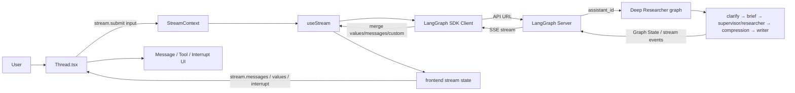
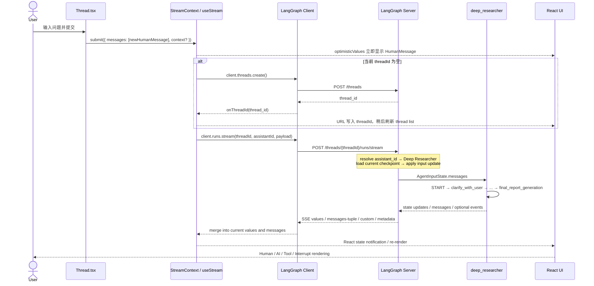

# P0-003 — Upstream Integration Boundary

> Phase 0 — Source Reconnaissance · Owner: 00-Architect · Development Mode: PAIR
>
> 目标只限于回答：一个用户请求如何从 Agent Chat UI 进入 `deep_researcher`，又如何通过 LangGraph streaming 回到 UI。

## 0. 范围与证据基线

本文基于 Workspace 中以下实际内容：

- `docs/source-review/open-deep-research.md`
- `docs/source-review/agent-chat-ui.md`
- `references/open_deep_research-main/`
- `references/agent-chat-ui-main/`
- UI snapshot 当前安装的 `@langchain/langgraph-sdk` 1.8.10 实现

两个 reference snapshot 都没有 `.git` metadata，因此本文不声明或猜测 commit SHA。

结论先行：**两者在 LangGraph Server Protocol 和顶层 `messages` state 上已经具备最小直连边界。** 对基本文本请求，只要 Agent Chat UI 指向可访问的 LangGraph Server，并把 `assistantId` 配置为当前注册的 `Deep Researcher` graph 或其 Assistant UUID，用户消息就能进入 `deep_researcher`，澄清消息或最终报告也能经 `messages` 回到现有 UI。

但“协议可直连”不等于“所有内部研究过程已产品化展示”。Open Deep Research 的 Supervisor / Researcher tool calls 和 tool results 位于 `supervisor_messages` / `researcher_messages`，不是主图顶层 `messages` 的稳定 UI Contract；当前 UI 也没有 Research Progress / Evidence Contract。

## 1. Source Review 校验结果

### 1.1 Open Deep Research

与当前 source 一致，影响连接边界的事实如下：

- `langgraph.json` 把 graph ID `Deep Researcher` 注册到 `deep_researcher.py:deep_researcher`。
- 主图 input schema 是 `AgentInputState`，其公开输入为 `messages`。
- `deep_researcher` 从 `START` 进入 `clarify_with_user`。
- 澄清问题、开始研究的确认消息以及最终报告都通过主图 `messages` 写回。
- Supervisor / Researcher 的内部消息和工具轨迹分别使用 `supervisor_messages` / `researcher_messages`。
- 当前所有主要模型调用都带有 `langsmith:nostream`，因此不能假定内部 token 或 tool-call chunk 会在 UI 中逐 token 展示；写入 Graph State 的消息仍可通过 state stream 到达 UI。

`open-deep-research.md` 无需为 P0-003 修正。

### 1.2 Agent Chat UI

原 Source Review 的总体边界正确。本任务只修正了两个会影响调用链理解的细节：

1. 首次 `submit` 且 `threadId == null` 时，当前 SDK 会先调用 `client.threads.create()`，取得 server 返回的 `thread_id`，再创建 run；不是把 thread 创建过程笼统归为“创建或解析”。
2. `streamMode: ["values"]` 是组件显式请求，不是最终唯一模式。`stream.messages` getter 会追踪 `messages-tuple` 与 `values`，已注册的 `onCustomEvent` 会追踪 `custom`；SDK 将它们合并、去重后发给 server。

## 2. 完整连接图



这里有两个不可混淆的选择轴：

```text
assistantId  → 这一次 run 执行哪个 graph / assistant configuration
threadId     → 这一次 run 读取和写入哪条服务端会话状态线
```

`threadId` 不是 messages 数组，也不选择 graph。

## 3. 一次首次请求的真实时序



详细过程：

1. `Thread.tsx` 创建带 UUID 的 HumanMessage。正常新问题提交的是本轮 message update，不是把 `threadId` 当消息载体，也不是无条件重发完整历史。若已有未配对 tool call，`ensureToolCallsHaveResponses()` 会附加隐藏的补偿 ToolMessage。
2. `optimisticValues` 先把新消息合入浏览器内存，使 UI 立即显示输入。它不是 checkpoint，server 拒绝请求时也不能被视为已持久化事实。
3. 没有 `threadId` 时，`useStream` 先经 LangGraph Server 创建 thread，取得 ID，并调用 `onThreadId`。已有 `threadId` 时直接复用。
4. SDK 以该 thread 创建 streaming run，request body 中包含 `assistant_id` 和 `input`。当前 Open Deep Research 的共享最小 input 是 `input.messages`。
5. LangGraph Server 根据 `assistant_id` 解析 graph / assistant，读取该 thread 的当前 checkpoint，把本轮 input 作为 Graph State update 应用，然后调用 `deep_researcher`。
6. `MessagesState` 的 message reducer 将新消息按 message ID 归并到已有 state。`clarify_with_user` 因此读取到当前 thread 中的用户会话上下文。
7. graph 运行时，LangGraph Server 负责把 state 和消息事件编码成 stream，并在 thread 边界保存 checkpoint；`deep_researcher` 自己不接收或保存前端的 `threadId` 字段。
8. SDK 消费 stream，维护 `stream.values`；`stream.messages` 是从当前 values 的 `messages` key 派生出的视图。React Context 更新后，`Thread.tsx` 重新渲染消息列表。

澄清轮次也沿用同一条链：`clarify_with_user` 追加 AI 追问后结束本次 run；用户在相同 `threadId` 下回答，下一次 run 从该 thread 已保存的 state 继续。

## 4. 连接 Contract

| Contract                  | 当前职责                                                                                                                                                            | 明确不负责                                                      |
| ------------------------- | ------------------------------------------------------------------------------------------------------------------------------------------------------------------- | --------------------------------------------------------------- |
| `apiUrl`                  | LangGraph API 的 transport base URL；供 `/info`、thread、run、state/history 请求使用。开发环境可直连 server，生产形态也可指向 Agent Chat UI 的 `/api` passthrough。 | 不选择 graph，不标识会话，不定义业务 state。                    |
| `assistantId`             | 传入 run 的 `assistant_id`，选择 graph ID 或一个具体 Assistant 配置。当前 snapshot 的 graph name 是精确字符串 `Deep Researcher`；UI 默认值 `agent` 不能代表它。     | 不保存消息，不代表 thread。                                     |
| `threadId`                | 标识 LangGraph Server 中一条可连续运行的 state/checkpoint 线；用于 run、history、branch、regenerate 和 resume。                                                     | 不直接承载 `messages` 数组，也不决定调用哪个 graph。            |
| `input.messages`          | 本轮提交给 graph 的 message update。Open Deep Research 以 `AgentInputState.messages` 接收，由 `MessagesState` reducer 与 thread 当前 state 归并。                   | 不是 checkpoint 本身，也不应承担 Research Progress / Evidence。 |
| streamed `values`         | server 发送的 Graph State snapshot；SDK 将其设为当前 `stream.values`。                                                                                              | 不是数据库读取 API，也不是所有历史 checkpoint 的集合。          |
| streamed `messages-tuple` | LLM/message chunk 通道；SDK 按 message ID 组装，并写回当前 values 的 `messages` 视图。                                                                              | 不保证每个 graph 内部字段都会自动成为顶层聊天消息。             |
| streamed `custom`         | 自定义低延迟事件通道；当前 UI 仅识别 Generative UI 的 `UIMessage` / `RemoveUIMessage`。                                                                             | 当前没有 ResearchFlow Research Event Contract。                 |
| checkpoint state          | server-side、thread-scoped 的可恢复 Graph State snapshot。                                                                                                          | 不等同于浏览器内的 optimistic state 或 `stream.messages`。      |

### 4.1 首次 submit 如何产生 thread

当前 `useStream` 的顺序是：

```text
threadId == null
  → client.threads.create()
  → server 返回 thread_id
  → onThreadId(thread_id)
  → client.runs.stream(thread_id, assistantId, ...)
```

`onThreadId` 只把 identity 反馈给 UI。真正的 thread state 和 checkpoints 仍在 LangGraph Server。

### 4.2 messages 如何进入 Graph State

当前提交的核心形状是：

```text
input = {
  messages: [optional repair ToolMessages..., new HumanMessage],
  context?: artifactContext
}
```

Open Deep Research 声明的 input 只有 `messages`。因此：

- 纯文本/多模态 HumanMessage 走共享 `messages` contract。
- Agent Chat UI 的可选 artifact `context` 没有对应的 Open Deep Research input contract；基本文本链路不依赖它。后续若保留 Artifact 功能，应显式定义映射，而不是假定 graph 会消费它。
- 旧消息来自相同 thread 的 checkpoint state，本轮 `messages` 是 update；归并规则由 graph 的 `MessagesState` 决定。

### 4.3 SDK 如何归并 server 返回值

当前有效模式是显式与隐式需求的并集：

```text
submit streamMode: values
+ stream.messages getter: messages-tuple, values
+ onCustomEvent callback: custom
= de-duplicated stream modes
```

归并行为：

- `values`：以 server state snapshot 更新当前 `stream.values`；先前 optimistic state 随权威 stream 结果被校正。
- `messages-tuple`：`MessageTupleManager` 按 message ID 合并 chunk，再更新 values 中的 `messages` key。
- `custom`：交给 `onCustomEvent(event, { mutate })`；当前实现只通过 `uiMessageReducer()` 更新 `values.ui`。
- `interrupt`：运行中可从 `values.__interrupt__` 暴露；非流式历史恢复时，也可从 thread state 的 tasks / next 推导。

`Thread.tsx` 读取 `stream.messages` 后，只负责过滤隐藏 ID、按 message type 路由并触发 React rendering。

### 4.4 Tool Call / Tool Result 如何进入 UI

UI 已支持标准形状：

```text
AIMessage.tool_calls[] → AssistantMessage → ToolCalls
ToolMessage            → AssistantMessage → ToolResult
```

它还可从 Anthropic streaming content 的 `tool_use` 结构做 fallback 解析。但当前 Open Deep Research 的研究工具轨迹有一层重要边界：

- 主图 `messages` 主要承载用户消息、澄清/确认 AIMessage 和最终报告 AIMessage。
- Supervisor tool calls / ToolMessages 位于 `supervisor_messages`。
- Researcher tool calls / ToolMessages 位于每个 `researcher_messages`。
- `stream.messages` 默认只读取 state 的 `messages` key。
- `streamSubgraphs: true` 允许接收带 namespace 的 subgraph stream，但它不是“把任意内部 state 字段提升为顶层 messages”的 Contract，也不应被当作稳定 Research Progress / Evidence API。
- Open Deep Research 给主要模型调用设置了 `langsmith:nostream`，进一步说明当前设计不以展示内部 token/tool chunk 为目标。

所以当前可直接得到的是“用户请求 → 澄清或最终报告”的聊天体验。UI 的 Tool rendering 能力值得复用，但若 ResearchFlow 要稳定展示研究工具轨迹，必须以后由明确的 state/event contract 暴露，不能依赖偶然的 subgraph stream 或解析 ToolMessage 文本。

### 4.5 checkpoint 与前端 stream state 的边界

```text
LangGraph Server
└── threadId
    ├── checkpoint 1: Graph State
    ├── checkpoint 2: Graph State
    └── checkpoint N: Graph State
             │
             ├── fetchStateHistory / branch / regenerate
             └── current run stream
                         │
                         ▼
Frontend useStream
└── current values
    ├── messages → stream.messages → Message UI
    ├── ui → Generative UI
    └── __interrupt__ → Interrupt UI
```

前端可以读取历史、选择 branch、从 parent checkpoint regenerate，但不拥有 server checkpoint。页面刷新后恢复依赖 server thread state；单纯的 `optimisticValues` 不能提供持久化或 replay。

## 5. 天然兼容与当前适配点

| 能力                         | 当前判断                             | 依据与边界                                                                                             |
| ---------------------------- | ------------------------------------ | ------------------------------------------------------------------------------------------------------ |
| 顶层 `messages` state        | 直接兼容                             | UI 要求 graph 有 `messages` key；Open Deep Research 的 input/output 正好使用 `MessagesState`。         |
| assistant / graph selection  | 配置即可                             | 设置为 `Deep Researcher` 或其 Assistant UUID；不能沿用 UI 默认 `agent`。                               |
| LangGraph thread             | 直接兼容                             | `useStream` 创建/复用 server thread，Open Deep Research 无需处理 `threadId`。                          |
| checkpoint/history           | 协议兼容                             | UI 开启 `fetchStateHistory`，持久化能力由所连接的 LangGraph Server runtime 提供。                      |
| state streaming              | 直接兼容                             | run 请求和 SSE 消费均由 SDK/Server 处理；graph 返回的 `messages` / `final_report` 可出现在 values。    |
| token streaming              | 有意受限                             | Open Deep Research 的主要模型调用带 `langsmith:nostream`；state 完成更新仍可返回。                     |
| Tool Call / Result rendering | 表示兼容，暴露边界不兼容             | UI 能显示标准 AIMessage/ToolMessage；Open Deep Research 的内部工具消息不在顶层 `messages`。            |
| interrupts                   | 基础设施兼容，当前 graph 未使用      | UI 支持 Agent Inbox 与 Generic Interrupt；当前澄清流程是 AIMessage + `END`，不是 LangGraph interrupt。 |
| custom events                | transport 可扩展，领域 Contract 缺失 | 当前 callback 只处理 Generative UI event；Open Deep Research 当前未定义 ResearchFlow 领域事件。        |

最小直连不需要新增 adapter service，也不需要修改主图：

```text
Agent Chat UI apiUrl       = 可访问的 LangGraph Server base URL
Agent Chat UI assistantId  = Deep Researcher（或对应 Assistant UUID）
Agent Chat UI threadId     = 首次为空，由 SDK/server 创建；后续复用
```

这里假定 server access/auth 已满足。Auth 属于本任务 Out of Scope，不据此扩展 ResearchFlow 的认证设计。

当前真正需要记录的适配点只有三项，均不在 P0-003 实现：

1. 不把 UI 默认 `agent` 当成已注册的 `Deep Researcher`。
2. 不把 Agent Chat UI 的 artifact `context` 当成 Open Deep Research 已支持的 input。
3. 不把 `streamSubgraphs` 或 ToolMessage 文本当成 Research Progress / Evidence Contract。

## 6. Design Harvest

分类含义：

- **REUSE**：边界和职责可直接沿用。
- **MIGRATE**：保留设计意图，迁入 ResearchFlow 所有权后再演进。
- **EXTEND**：保留现有 seam，在旁边增加 ResearchFlow 领域能力。
- **REPLACE**：不要延续该设计作为 ResearchFlow 的正式 Contract。

### 6.1 Open Deep Research

| 设计能力                                                   | 分类    | Harvest 结论                                                                                                                          |
| ---------------------------------------------------------- | ------- | ------------------------------------------------------------------------------------------------------------------------------------- |
| `clarify → brief → supervisor → writer` 主编排             | MIGRATE | 保留主阶段和入口语义；未来需求变化应在 ResearchFlow 自有 graph 中演进，不直接把 upstream snapshot 当产品代码永久依赖。P0-003 不迁移。 |
| Supervisor / Researcher 分工与并发委派                     | REUSE   | Supervisor 规划、Researcher 聚焦单 topic 的边界清晰，可作为后续编排基础。                                                             |
| `bind_tools → tool_calls → *_tools → ToolMessage` 执行循环 | EXTEND  | 保留 LangChain/LangGraph 原生工具协议；未来 Knowledge tool 通过明确接口加入，不让 Agent 依赖具体 Vector DB。                          |
| Researcher 末端 Compression                                | MIGRATE | 保留“在子任务边界压缩局部上下文”的设计目的；未来输入/输出需适配 Evidence。                                                            |
| 独立 Writer stage                                          | MIGRATE | 保留 Writer 作为独立消费端；当前 `notes` 输入组装不是已批准的 ResearchFlow Writer Contract。                                          |
| 从 ToolMessage 文本推断领域 Evidence / Progress            | REPLACE | 当前 upstream 并未提供该领域 Contract；ResearchFlow 明确不采用文本推断。                                                              |

### 6.2 Agent Chat UI

| 设计能力                                                | 分类    | Harvest 结论                                                                              |
| ------------------------------------------------------- | ------- | ----------------------------------------------------------------------------------------- |
| LangGraph `Client` 与 `useStream` transport             | REUSE   | 已覆盖 thread、run、stream、history、resume 的协议细节。                                  |
| `StreamContext` 集中当前 run/session                    | EXTEND  | 保留 Context seam，在 typed state / custom event 层增加 ResearchFlow 领域状态。           |
| 首次 thread 创建、URL threadId、history/branch handling | REUSE   | identity 与 current stream 分离合理；以后再增加 project-scoped metadata，不在本任务设计。 |
| Message / Tool / Interrupt rendering                    | REUSE   | 保留标准协议对象的被动展示职责。                                                          |
| Tool component 承担 Research Progress                   | REPLACE | Tool view 只展示单次调用/结果，不能成为 run-level research state owner。                  |
| Generative UI `ui` state                                | REUSE   | 继续服务动态 message-associated UI；不默认拿它替代稳定的 ResearchFlow Evidence UI。       |

## 7. 暂不解决的后续问题

### A. Writer input boundary

当前事实：Supervisor 结束时，`get_notes_from_tool_calls(supervisor_messages)` 提取 Supervisor 历史中的全部 ToolMessage 内容作为 `notes`；Writer 再把 `notes` 拼接为 `findings`。因此输入可能同时包含 `ConductResearch` 压缩结果、`think_tool` 反思和并发溢出错误等内容。

这是 ResearchFlow 后续 Evidence / Writer 边界设计必须重新评估的点。P0-003 不修改实现，也不预设最终 Evidence Schema。

### B. Research Event Contract

**ARCHITECTURE DECISION REQUIRED**

当前事实：Agent Chat UI 已有 typed state 与 `custom` event 接收/归并 seam；Open Deep Research 当前没有 ResearchFlow 的 Progress / Evidence event。

后续需要单独决定 event schema、事件粒度、持久化状态与瞬时事件的关系以及 replay semantics。P0-003 不做这些设计，也不允许通过解析 tool result 文本临时代替 Contract。

## 8. PAIR 理解与排障入口

### 应能独立解释的七个答案

1. **为什么可以连接：** 双方共享 LangGraph Server Protocol，且 graph input/output 与 UI 都以顶层 `messages` 为最小公共 state。
2. **`assistantId`：** 选择执行对象；是 graph name 或 Assistant UUID。
3. **`threadId`：** 选择 server-side state/checkpoint 线；不是消息数组。
4. **输入如何进入 graph：** `stream.submit()` → 必要时创建 thread → `runs.stream()` → server 应用 `input.messages` → `deep_researcher` 从 `clarify_with_user` 开始。
5. **结果如何回来：** graph state/message events → LangGraph Server SSE → SDK 归并 → `stream.values` / `stream.messages`。
6. **如何变成 UI：** `Thread.tsx` 遍历 `stream.messages`，Human 与其他消息分别进入 HumanMessage / AssistantMessage，再路由 Tool 与 Interrupt。
7. **现在不改什么：** 不改主图、不设计 Evidence/Event Schema、不把内部 ToolMessage 偶然暴露当正式 Contract。

### 出错时优先排查

```text
连不上 server
  → apiUrl / /info / proxy / access precondition

server 返回 graph/assistant not found
  → assistantId 是否精确为 Deep Researcher 或有效 Assistant UUID

首次发送没有 thread
  → POST /threads、onThreadId、URL query state

graph 没收到用户消息
  → Thread.tsx submit payload → input.messages → AgentInputState

UI 没显示最终答案
  → final_report_generation 是否写 messages → values/messages stream → stream.messages

UI 没显示内部工具过程
  → 先确认它们位于 supervisor_messages/researcher_messages；这不是顶层 messages 的当前 Contract

刷新后状态丢失
  → LangGraph Server thread/checkpoint persistence，而不是 optimisticValues
```

### Change Challenge（不在本任务实施）

在后续最小 smoke test 中，把 UI 的 `assistantId` 从 graph name `Deep Researcher` 切换为该 graph 的某个 Assistant UUID，并回答：

- request body 和 thread search filter 哪两处语义发生变化？
- 为什么现有 `threadId` 的职责没有变化？
- 为什么这项修改不需要触碰 `deep_researcher` 的 `messages` schema？

## 9. 关键源码入口

Open Deep Research：

- `references/open_deep_research-main/langgraph.json`
- `references/open_deep_research-main/src/open_deep_research/state.py`
- `references/open_deep_research-main/src/open_deep_research/deep_researcher.py`

Agent Chat UI：

- `references/agent-chat-ui-main/src/providers/Stream.tsx`
- `references/agent-chat-ui-main/src/providers/Thread.tsx`
- `references/agent-chat-ui-main/src/providers/client.ts`
- `references/agent-chat-ui-main/src/components/thread/index.tsx`
- `references/agent-chat-ui-main/src/components/thread/messages/ai.tsx`
- `references/agent-chat-ui-main/src/components/thread/messages/tool-calls.tsx`
- `references/agent-chat-ui-main/src/app/api/[..._path]/route.ts`

SDK 行为校验入口：

- `references/agent-chat-ui-main/node_modules/@langchain/langgraph-sdk/dist/react/stream.lgp.js`
- `references/agent-chat-ui-main/node_modules/@langchain/langgraph-sdk/dist/ui/manager.js`
- `references/agent-chat-ui-main/node_modules/@langchain/langgraph-sdk/dist/client.js`
